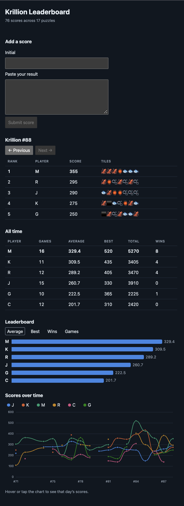

# Krillion Leaderboard

A leaderboard for my friend group's daily Krillion scores. Paste the share text from the game, and the site ranks everyone for the day and across all time.

**Live:** https://markchauhan.github.io/krillion-leaderboard/



## What it does

- **Daily board.** One puzzle's scores, ranked, with ties sharing a rank (1, 2, 2, 4). It opens on the latest puzzle, with buttons to step to earlier ones.
- **All-time table.** Games played, average, best score and wins for each player.
- **Bar chart leaderboard.** Compare players by average, best, wins or games.
- **Line chart.** Each player's score by puzzle, with gaps for days they missed.
- **Submit from the page.** Paste a result, type an initial, and it is saved to the database. The paste is parsed and validated as you type.

Players are shown by initial only.

## How it works

```
Share text ──> parseShare ──> Supabase (Postgres) ──> loadScores ──> rank ──> React components
```

- `src/lib/` holds the logic as plain TypeScript with no React in it: parsing the share text, ranking, all-time stats, and deduplication. This is where the tests are.
- `src/components/` only draws what it is given. No component sorts, ranks or fetches.
- `src/hooks/useScores.ts` loads scores and reports loading, error or ready as a discriminated union, so the UI has to handle all three.
- The database is a single `scores` table with a composite primary key of `(puzzle, name)`, which enforces one score per player per puzzle. Row level security allows anyone to read and insert, and nobody to update or delete.

A few decisions worth noting:

- **Parsers return a result, they do not throw.** `parseShare` returns `{ ok: true, value } | { ok: false, error }`, so the caller cannot use a score without checking that parsing succeeded.
- **Emoji are split with `Intl.Segmenter`.** An emoji can span several UTF-16 code units, so indexing the string directly cuts tiles in half.
- **Validation lives in the database too.** `check` constraints reject bad rows even if a request skips the front end.

## Stack

React 19, TypeScript (strict), Vite, Vitest, Supabase (Postgres), GitHub Actions, GitHub Pages. Everything runs on free tiers.

## Run it locally

Requires Node 20.19+ or 22.12+.

```bash
git clone https://github.com/markchauhan/krillion-leaderboard.git
cd krillion-leaderboard
npm install
npm run dev
```

Then open http://localhost:5173/krillion-leaderboard/

The `.env` file is committed on purpose. It holds the Supabase project URL and publishable key, both of which are public by design; row level security is what protects the data.

| Command | What it does |
| --- | --- |
| `npm run dev` | Start the dev server |
| `npm test` | Run the tests in watch mode |
| `npm run build` | Type-check and build to `dist/` |
| `npm run lint` | Run ESLint |

Every push to `main` runs the tests, lint and build on GitHub Actions, then deploys to GitHub Pages. A failing test blocks the deploy.

## Database setup

To point this at your own Supabase project, run the following in the SQL editor and put your project URL and publishable key in `.env`.

```sql
create table scores (
  puzzle     integer     not null check (puzzle > 0),
  name       text        not null check (length(trim(name)) between 1 and 30),
  score      integer     not null check (score >= 0),
  emojis     text        not null,
  created_at timestamptz not null default now(),
  primary key (puzzle, name)
);

alter table scores enable row level security;

create policy "Anyone can read scores" on scores for select using (true);
create policy "Anyone can add a score" on scores for insert with check (true);
```

There is no login or passcode. This is built for a small group that shares the link, so anyone with the URL can add a score. They cannot edit or delete existing ones.
